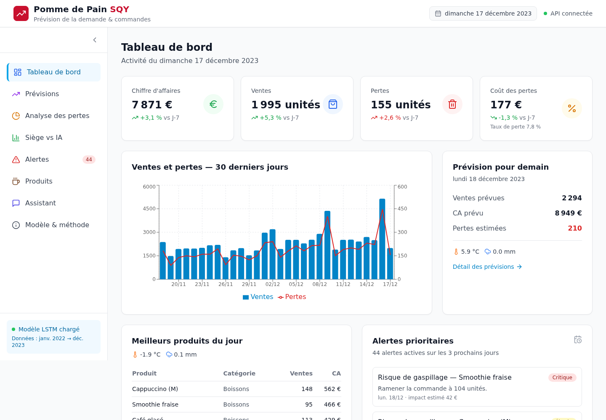
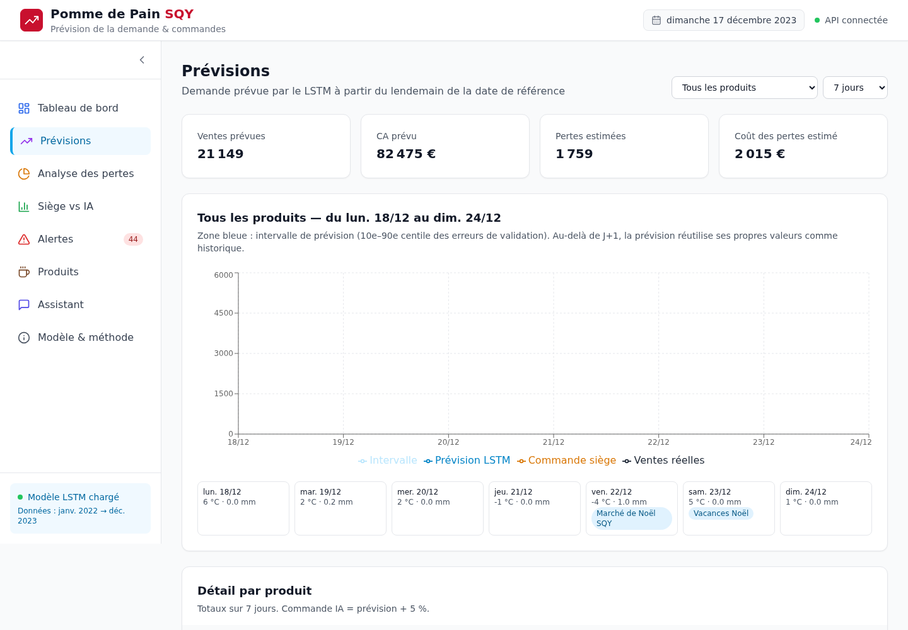
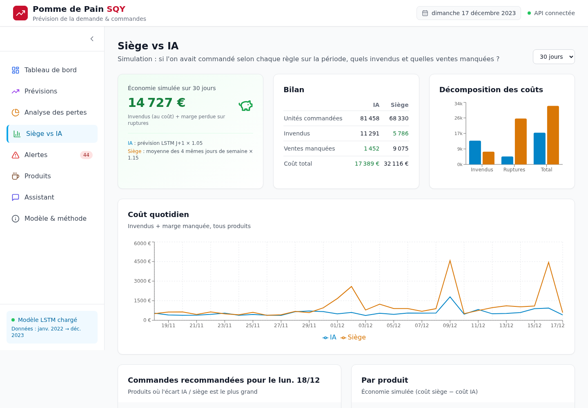
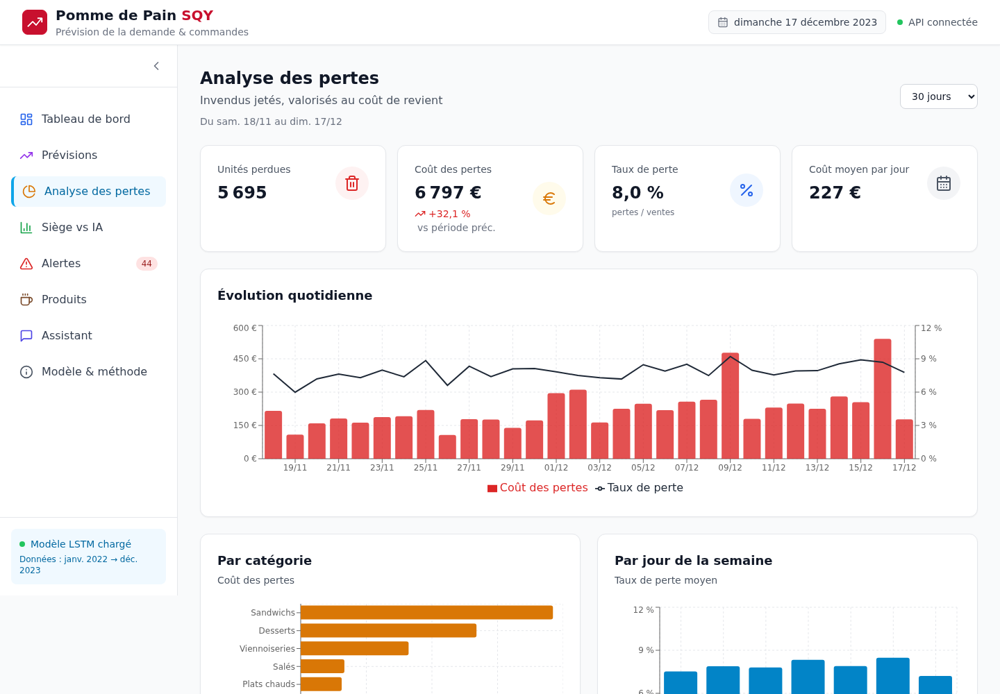
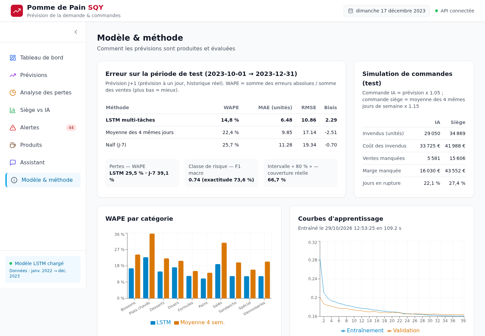

# Pomme de Pain ML — prévision de la demande et commandes

> 🇬🇧 [English version](README.md)

Application complète (données → modèle → API → interface) qui prévoit les ventes et les pertes de chaque produit
d'un point de vente de restauration rapide à Saint-Quentin-en-Yvelines, et recommande les quantités à commander.
Les recommandations sont comparées à la règle de commande actuelle du siège.

Projet de fin d'année (PFA), iTeam University.

> Projet académique, sans lien avec l'enseigne Pomme de Pain ni approuvé par elle. Toutes les données sont simulées.



## Résultats

Évaluation sur la période de test **octobre–décembre 2023** (jamais vue pendant l'entraînement), prévision à J+1,
50 produits × 92 jours :

| Méthode | WAPE ventes | MAE (unités / produit / jour) |
|---|---:|---:|
| **LSTM multi-tâches** | **14,8 %** | **6,5** |
| Moyenne des 4 mêmes jours de semaine | 22,4 % | 9,8 |
| Naïf J-7 | 25,7 % | 11,3 |

Simulation de commandes sur la même période (IA = prévision × 1,05 ; siège = moyenne des 4 mêmes jours × 1,15) :

| | IA | Siège |
|---|---:|---:|
| Coût des invendus | 33 725 € | 41 988 € |
| Marge perdue sur ruptures | 16 030 € | 43 552 € |

Les chiffres sont recalculés par `make train` et exposés dans `backend/artifacts/metrics.json`
et dans la page *Modèle & méthode* de l'interface.

**Limites connues** : l'intervalle de prévision « 80 % », calibré sur l'été, ne couvre que 67 % des ventes réelles
en fin d'année ; la simulation prend les ventes observées comme demande réelle (la demande perdue lors des ruptures
passées n'est pas visible).

> Les données sont **simulées** (fictives mais réalistes) : aucune donnée réelle de l'enseigne n'est utilisée.

## Architecture

```
preprocessing/   Chargement, validation, nettoyage, features et split temporel (pandas)
  data/raw/      Jeu de données simulé : ventes par produit et par jour, produits, météo, événements SQY
backend/         API FastAPI + modèle PyTorch
  app/ml/        features.py (définition unique des features), model.py (LSTM), predictor.py
  app/services/  règles de commande, alertes, tables de prévision
  app/routes/    dashboard, forecasts, losses, comparison, alerts, products, events, chatbot
  scripts/train.py   entraînement + évaluation → artifacts/model.pt, artifacts/metrics.json
frontend/        React 18 + Vite + Tailwind + Recharts
```

**Modèle** : LSTM 2 couches (64 unités) avec attention temporelle et connexion résiduelle, et trois têtes
(ventes, pertes, classe de risque de gaspillage). L'entrée est une fenêtre de 28 jours. Chaque jour contient les
ventes et pertes de la veille, les ventes de J-7, la moyenne sur 7 jours, le calendrier (jour, saison, férié),
la météo, l'impact des événements et les caractéristiques du produit. Les ventes sont normalisées par produit.
Pour prévoir au-delà de J+1, la prévision est récursive.

**Alertes** : générées à partir des prévisions des 3 prochains jours. Une *rupture* est signalée quand la
commande du siège est sous la borne basse de la prévision, un *gaspillage* quand elle dépasse la borne haute.
Les événements SQY prévus produisent aussi une alerte. L'état « résolu » est stocké dans une base SQLite.

**Assistant** : détection d'intention par mots-clés et réponses construites à partir des données et des
prévisions (prévision d'un produit, alertes, pertes, meilleures ventes, événements, procédures internes).

## Lancer le projet

Prérequis : Python 3.10+, Node 20+.

```bash
make setup        # venv .venv + dépendances Python (torch CPU) + npm ci
make api          # API  → http://localhost:8642  (Swagger : /docs)
make web          # UI   → http://localhost:5190
```

Les ports sont volontairement peu courants. Ils se changent avec `make api API_PORT=9000` et
`make web WEB_PORT=5200 API_PORT=9000`. Le modèle entraîné est versionné dans `backend/artifacts/`,
il n'est donc pas nécessaire de le réentraîner pour lancer la démo.

Autres commandes :

```bash
make test         # tests backend (pytest)
make train        # réentraîne le modèle (~2 min sur CPU)
make preprocess   # régénère preprocessing/data/interim et processed
make lint build   # lint + build du frontend
```

Avec Docker :

```bash
docker compose up --build          # API :8642, UI :5190
```

### Date de référence

Les données couvrent 2022–2023. L'application se place à une date « aujourd'hui » fixe, par défaut le
**17/12/2023** (14 jours avant la fin des données). Les prévisions des jours suivants peuvent ainsi être comparées
aux ventes réelles. Cette date se change avec `REFERENCE_DATE` (voir `backend/.env.example`).

## Captures

| Prévisions | Siège vs IA |
|---|---|
|  |  |
| **Analyse des pertes** | **Modèle & méthode** |
|  |  |

## API

| Endpoint | Description |
|---|---|
| `GET /health` | État, date de référence, modèle chargé |
| `GET /api/v1/dashboard` | KPI du jour, tendance 30 j, prévision du lendemain, alertes prioritaires |
| `GET /api/v1/forecasts?days=7&product_id=` | Prévisions (total et par produit), commandes IA / siège |
| `GET /api/v1/forecasts/accuracy` | Métriques d'évaluation |
| `GET /api/v1/forecasts/backtest?days=30` | Prévisions J+1 passées vs ventes réelles |
| `GET /api/v1/losses?days=30` | Pertes par catégorie, produit, jour de semaine, contexte |
| `GET /api/v1/comparison?days=30` | Simulation siège vs IA, recommandations du lendemain |
| `GET /api/v1/alerts` · `POST /api/v1/alerts/{id}/resolve` | Alertes et résolution |
| `GET /api/v1/products` · `GET /api/v1/products/{id}` | Catalogue, statistiques, prévision par produit |
| `GET /api/v1/events` | Calendrier SQY et impact mesuré |
| `POST /api/v1/chatbot/message` | Assistant |

## Licence

[MIT](LICENSE) © 2026 Lamis Essid
