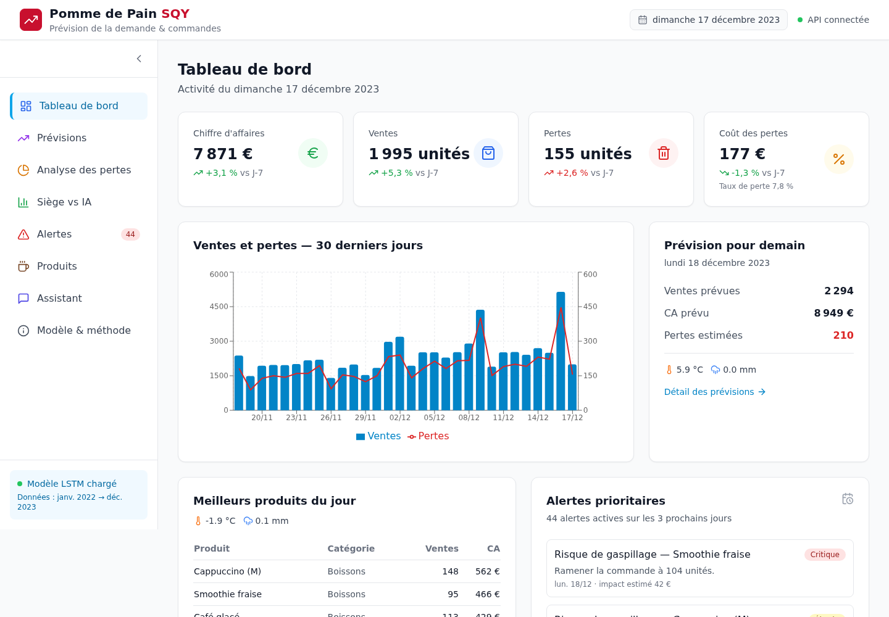
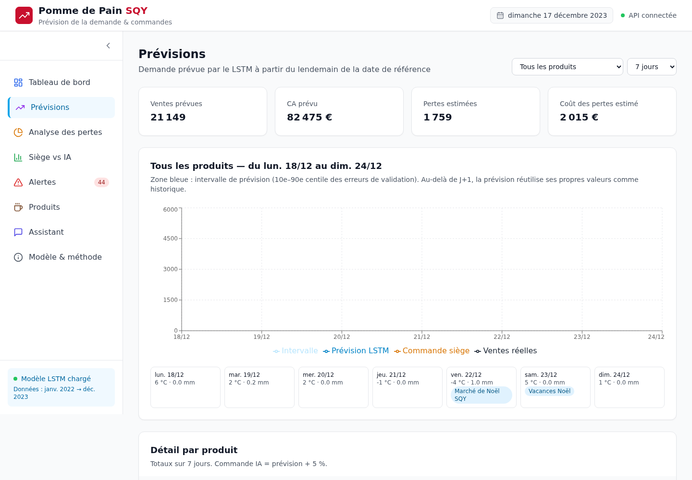
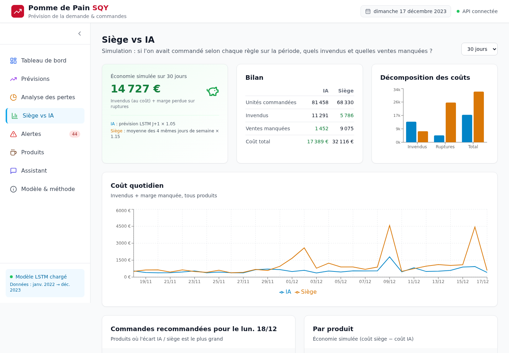
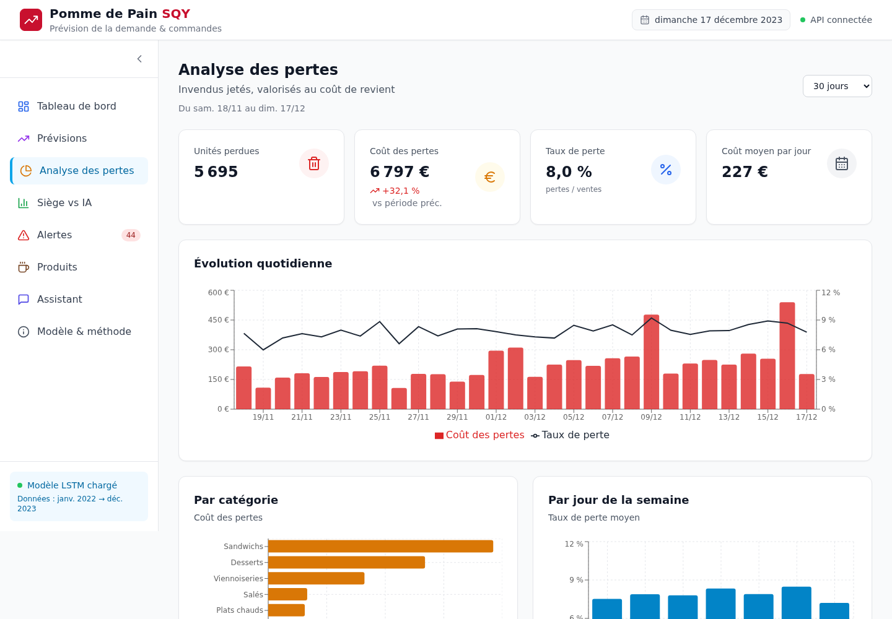
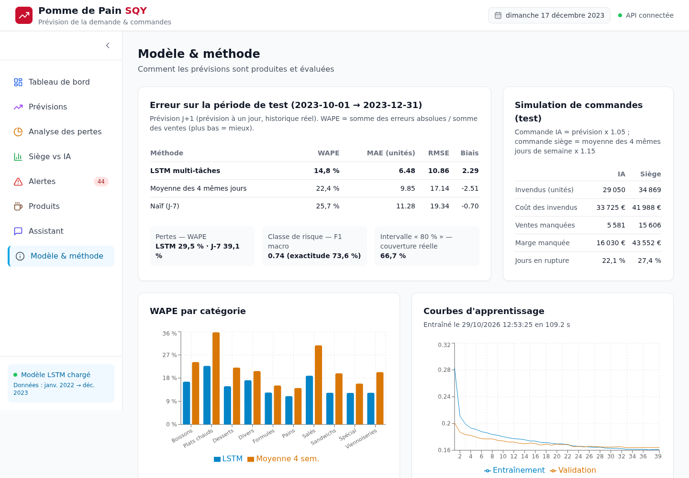

# Pomme de Pain ML: demand forecasting and order optimisation

> 🇫🇷 [Version française](README.fr.md)

End-to-end application (data → model → API → web UI) that forecasts the daily sales and waste of every product
in a fast-food outlet in Saint-Quentin-en-Yvelines (France), and recommends how much to order.
The recommendations are compared with the head office's current ordering rule.

Final-year project (PFA), iTeam University.

> **Academic project, not affiliated with or endorsed by the Pomme de Pain brand. All data is simulated**
> (fictitious but realistic): no real data from the brand is used.



*The user interface is in French.*

## Results

Evaluation on the **October–December 2023** test period (never seen during training), one-day-ahead forecast,
50 products × 92 days:

| Method | Sales WAPE | MAE (units / product / day) |
|---|---:|---:|
| **Multi-task LSTM** | **14.8 %** | **6.5** |
| Mean of the same weekday over the last 4 weeks | 22.4 % | 9.8 |
| Seasonal naive (D-7) | 25.7 % | 11.3 |

Order simulation over the same period (AI = forecast × 1.05; head office = mean of the same weekday over the last
4 weeks × 1.15):

| | AI | Head office |
|---|---:|---:|
| Cost of unsold items | €33,725 | €41,988 |
| Margin lost to stock-outs | €16,030 | €43,552 |

These figures are recomputed by `make train` and exposed in `backend/artifacts/metrics.json`
and on the *Modèle & méthode* (model & method) page of the UI.

**Known limitations:** the "80 %" forecast interval, calibrated on summer data, only covers 67 % of actual sales
at year end; the simulation treats observed sales as true demand (demand lost during past stock-outs is not
visible).

## Architecture

```
preprocessing/   Loading, validation, cleaning, features and temporal split (pandas)
  data/raw/      Simulated dataset: daily sales per product, products, weather, local events (SQY)
backend/         FastAPI API + PyTorch model
  app/ml/        features.py (single feature definition), model.py (LSTM), predictor.py
  app/services/  ordering rules, alerts, forecast tables
  app/routes/    dashboard, forecasts, losses, comparison, alerts, products, events, chatbot
  scripts/train.py   training + evaluation → artifacts/model.pt, artifacts/metrics.json
frontend/        React 18 + Vite + Tailwind + Recharts
```

**Model:** 2-layer LSTM (64 units) with temporal attention and a residual connection, and three heads
(sales, waste, waste-risk class). The input is a 28-day window. Each day contains the previous day's sales and
waste, sales at D-7, the 7-day mean, calendar features (weekday, season, public holiday), weather, event impact
and product characteristics. Sales are normalised per product. Beyond D+1, forecasting is recursive.

**Alerts:** generated from the forecasts for the next 3 days. A *stock-out* alert is raised when the head
office's order is below the lower bound of the forecast, a *waste* alert when it exceeds the upper bound.
Upcoming local events also trigger an alert. The "resolved" state is stored in a SQLite database.

**Assistant:** keyword-based intent detection, with answers built from the data and the forecasts (product
forecast, alerts, waste, best sellers, events, internal procedures).

## Getting started

Requirements: Python 3.10+, Node 20+.

```bash
make setup        # .venv + Python dependencies (CPU torch) + npm ci
make api          # API → http://localhost:8642  (Swagger: /docs)
make web          # UI  → http://localhost:5190
```

The ports are deliberately uncommon. Change them with `make api API_PORT=9000` and
`make web WEB_PORT=5200 API_PORT=9000`. The trained model is versioned in `backend/artifacts/`,
so there is no need to retrain it to run the demo.

Other commands:

```bash
make test         # backend tests (pytest)
make train        # retrain the model (~2 min on CPU)
make preprocess   # regenerate preprocessing/data/interim and processed
make lint build   # frontend lint + build
```

With Docker:

```bash
docker compose up --build          # API :8642, UI :5190
```

### Reference date

The data covers 2022–2023. The application uses a fixed "today" date, **17/12/2023** by default
(14 days before the end of the data), so that forecasts for the following days can be compared with actual
sales. Change it with `REFERENCE_DATE` (see `backend/.env.example`).

## Screenshots

| Forecasts | Head office vs AI |
|---|---|
|  |  |
| **Waste analysis** | **Model & method** |
|  |  |

## API

| Endpoint | Description |
|---|---|
| `GET /health` | Status, reference date, model loaded |
| `GET /api/v1/dashboard` | Today's KPIs, 30-day trend, next-day forecast, priority alerts |
| `GET /api/v1/forecasts?days=7&product_id=` | Forecasts (total and per product), AI / head-office orders |
| `GET /api/v1/forecasts/accuracy` | Evaluation metrics |
| `GET /api/v1/forecasts/backtest?days=30` | Past D+1 forecasts vs actual sales |
| `GET /api/v1/losses?days=30` | Waste by category, product, weekday, context |
| `GET /api/v1/comparison?days=30` | Head office vs AI simulation, next-day recommendations |
| `GET /api/v1/alerts` · `POST /api/v1/alerts/{id}/resolve` | Alerts and resolution |
| `GET /api/v1/products` · `GET /api/v1/products/{id}` | Catalogue, statistics, per-product forecast |
| `GET /api/v1/events` | Local event calendar and measured impact |
| `POST /api/v1/chatbot/message` | Assistant |

## License

[MIT](LICENSE) © 2026 Lamis Essid
